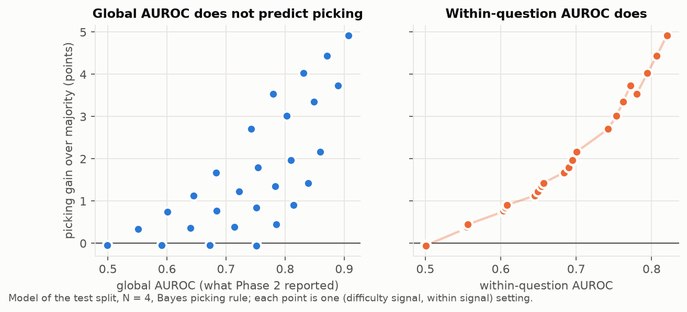
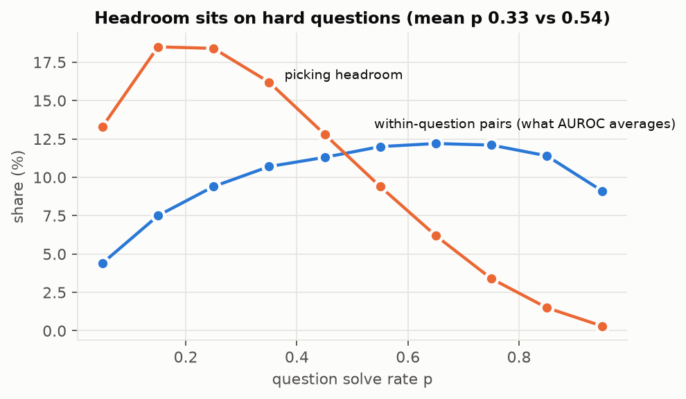
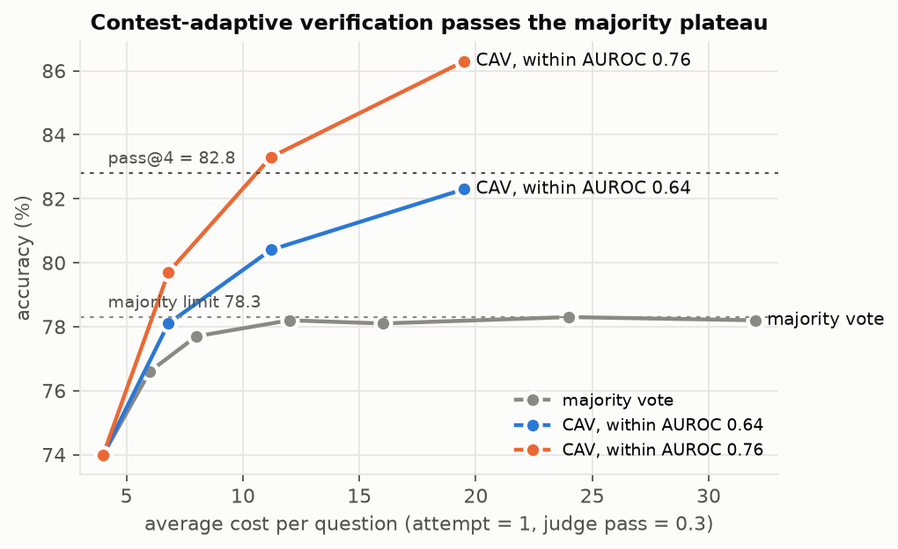
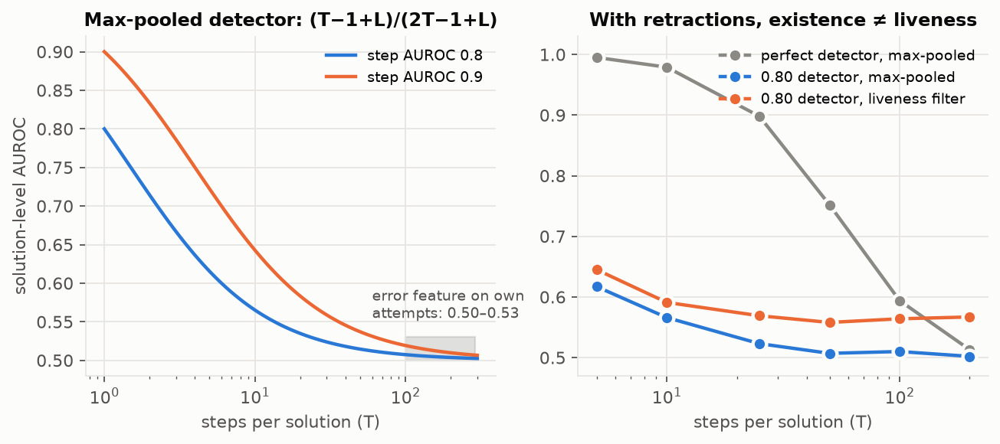
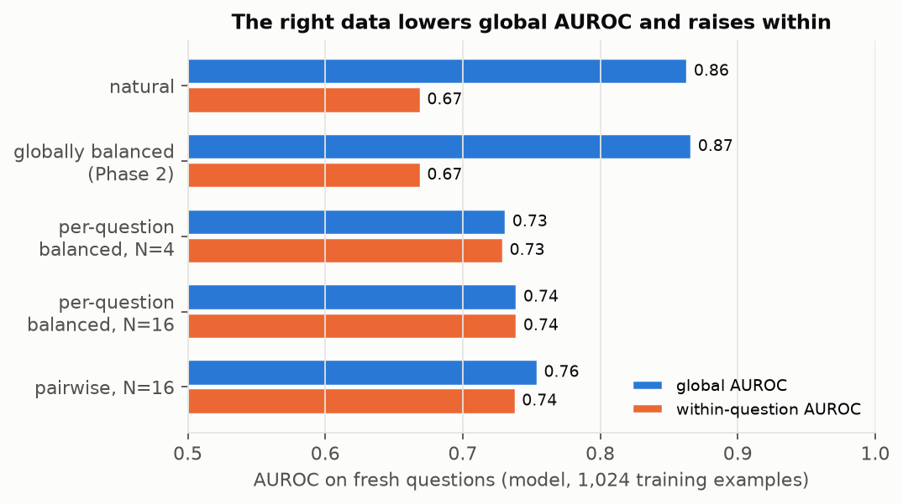

# Phase 3: theory of the verification–selection gap, and a plan for a positive result

October 2026. Builds on `phase2/docs/phase2-full-report.md` and the external research roadmap. Every number here comes either
from the Phase-2 report or from the model in `model/`. Each `m*.py` runs in seconds to a minute with numpy and scipy;
its output is saved next to it as `m*.out`. `make_figures.py` draws `figures/`. No GPU was used.

---

## 0. Summary

**The puzzle.** The self-judge raised own-attempt AUROC from 0.568 to 0.665 (replicated on test), but picking 1 of 4
stayed at 75.2. Repair would be worth about 7 points with perfect flags but gave +0.4. Every judge looked near chance
on the model's own attempts.

**The explanation.** A calibrated model of the solver and the judge reproduces these numbers. It needs three solver
parameters fitted per split and two judge parameters fitted to one table. In this setup, these outcomes are what the
mathematics predicts.

| # | Result | What it explains or changes |
|---|---|---|
| **R0** | **The own-attempt AUROCs are mostly a measurement artifact of a lenient judge.** One latent judge fitted to section 4's single-verdict flag rates (7.4% vs 2.2%) has d′ = 0.57 and latent AUROC **0.715**. With no further fitting it predicts 0.526 with 1 verdict (reported 0.53) and **0.568 with 4 verdicts (section 13 measured 0.568)**. Moving only its criterion, to about 28% "incorrect" verdicts, gives **0.665, the self-judge's value**. | "Judging own attempts is near chance" may be false: the judge almost always says "correct", so sampled verdicts hide its signal. The self-judge's gain is reproduced by a criterion shift alone, with no change in discrimination. This explains why picking did not move. |
| R1 | Only **0.076%** of the (right, wrong) pairs behind a 400 × 4 global AUROC come from the same question. | Global AUROC measures *between-question* ranking. A difficulty-only score reaches **0.94**. |
| R2 | **Invariance theorem.** Selection and resampling repair use only within-question information. Exactly: repair gain = −E_x[Cov(flag, correct \| x)]. | A difficulty-only judge gives exactly zero gain, at any global AUROC. |
| R3 | At N = 4, the 8.7-point headroom is 5.7 points of ties and 3.0 points of overturning. The tie gain has a closed form: 6.7%·(M₄(d) − ¼) + 1.3%·(Φ(d) − ½). Headroom sits on hard questions (mean p 0.33); AUROC pairs sit on medium ones (0.54). | Summed-confidence picking can fall below majority; tie-breaking-only picking cannot. Both Phase-2 judges' +1.2 fits an unchanged within-question skill. |
| R4 | Majority saturates at P(right answer is the mode) = **78.3%**. Log-odds aggregation keeps rising; argmax does not. **Compute-matched, a judge cannot beat majority at budgets ≤ 8 attempts.** Phase 2 ran at 4 attempts + 4 verdicts. | Verification pays only after self-consistency saturates. |
| R5 | **Contest-adaptive verification (CAV)** stops on unanimous questions (50% after 4 attempts) and judges only the top-2 answer groups, scored by verdict-token probability. It reaches **80.4–83.3% at an average cost of 11** vs majority's 78.2% (+2.2 to +5.1). 200–760 questions give 80% power. | The cheapest route to a positive SOLVE result needs no training. R0 suggests the existing judges' latent skill (≈ 0.71) sits inside this range. |
| R6 | **Length law** (T − 1 + L)/(2T − 1 + L), exact under Gumbel noise. **Liveness:** in long traces even a perfect error detector falls to chance, because correct traces contain retracted errors. | Explains the error feature (0.80 on ProcessBench → 0.50–0.53 on own attempts) without "self-blindness". |
| R7 | **Pointwise–selection misalignment.** When a judge infers difficulty from cues that vary between attempts (e.g. length), the pointwise-optimal judge puts weight on them, which adds within-question noise: within d′ = d·θ_w/√(θ_b² + θ_w²). Global rebalancing does not fix it; per-question balance does. In the learning model, per-question/pairwise data raises within-question AUROC 0.67 → 0.74 while *lowering* global AUROC 0.86 → 0.74. | Train on per-question-balanced or pairwise own attempts, and **never select checkpoints by global AUROC**. |
| R8 | Correction by fresh resampling is dominated by selection given the same samples. Correction adds value only through *feedback lift*: the regenerated attempt must succeed more often than p_x. Phase-2 hints measured lift ≈ 0. | Direction D is a separate problem (learned feedback, STV-style), not a by-product of a better judge. |

Two model predictions were checked against Phase-2 data that was **not** used in fitting:

- The 8-try always-right / always-wrong shares: predicted 0.43 / 0.12, observed 0.39 / 0.11.
- The repair gain from the mixed JUDGE's flags: predicted +0.30, observed +0.38.

R0's 4-verdict prediction (0.568) is a third.

---

## 1. Model and calibration (`m1_calibrate.py`, `m2_selection.py`)

**Solver.** Question x has solve rate p_x ~ Beta(a, b). Right attempts share the true answer. A wrong attempt gives
the question's "attractor" wrong answer with probability ρ, otherwise a wrong answer of its own. Majority breaks ties
at random. Each split is fitted with three numbers:

| Split | Single attempt | pass@4 | Majority | Fit |
|---|---|---|---|---|
| Test 400 × 4 | 67.4 | 82.8 | 74.0 | Beta(0.459, 0.222), ρ = 0.37 |
| Dev 200 × 4 | 69.8 | 86.5 | 77.5 | Beta(0.611, 0.265), ρ = 0.36 |

Both fits are U-shaped: questions are mostly "almost always right" or "almost always wrong".

**Judge.** Each attempt gets a latent score u_i = c₀ + γ·z_x + d·Z_i + η_i, where:

- z_x is the standardized logit of p_x (the judge's sense of difficulty) and Z_i is correctness;
- η_i ~ N(0, 1) can be shared with weight ρ_s by attempts that give the same answer;
- each of V verdicts says "correct" with probability Φ(u_i), and q_i is the share of "correct" verdicts;
- **d** is the within-question signal, **γ** the between-question signal and **c₀** the leniency.

---

## 2. R0: leniency and verdict sampling hide the judge's discrimination (`m10_verdicts.py`)

A binary verdict with hit rate H (flags a wrong attempt) and false-alarm rate F has AUROC = (1 + H − F)/2, which is
tiny when the judge rarely says "incorrect". Section 4's mixed JUDGE (H = 7.4%, F = 2.2%) gives 0.526, reported as
0.53. In signal-detection terms the same rates give **d′ = z(H) − z(F) = 0.57**.

Fit the latent judge to those two rates: c₀ = 2.05 and d = 0.80, with no difficulty term.

| Scoring of the same latent judge | AUROC |
|---|---|
| 1 sampled verdict | 0.526 (section 4: 0.53) |
| 4 sampled verdicts, share "incorrect" | **0.568** (section 13, untrained mixed judge, test: 0.568; dev 0.567) |
| 16 sampled verdicts | 0.621 |
| Latent score (what a verdict-token probability reads) | **0.715** |

**Criterion-shift hypothesis (H2).** Keep d = 0.80 and move only c₀:

| c₀ | +2.05 | +1.0 | +0.5 | 0.0 |
|---|---|---|---|---|
| Share of "incorrect" verdicts | 4% | 15% | 24% | 36% |
| AUROC, 4 verdicts | 0.566 | 0.637 | 0.659 | 0.672 |

The self-judge's 0.665 corresponds to about 28% "incorrect" verdicts. Its training set was 48.9% wrong, which rewards
saying "incorrect" more often. So **the whole Phase-2 AUROC gain is reproduced by a criterion shift with unchanged
discrimination.** A less lenient criterion does make q a bit more informative for picking (about +1 point in the
model), which is within the noise of the observed 0.0.

How much of the latent signal sampled verdicts capture (the gain over chance, as a share of the latent's gain):

| Judge | 1 verdict | 2 verdicts | 4 verdicts |
|---|---|---|---|
| Balanced (c₀ = 0) | 50% | 67% | 80% |
| Lenient (c₀ = 1.5) | 20–24% | 33–37% | 46–52% |

**Implications.**

1. Phase-2 statements that own-attempt judging is "near chance" (sections 4, 7, 10) measured verdict leniency as much
   as skill. Reading the verdict-token probability, or forcing a balanced criterion, should raise the reported numbers
   without any training (**prediction P-0a**).
2. The self-judge's latent (probability-scored) AUROC should be close to the untrained judge's (**P-0b**; H2). If it
   is clearly higher, training did improve discrimination.
3. **P-0c (checkable on any cached 4-verdict data):** verdicts on the same attempt are strongly correlated. The
   implied judge gives this distribution of "incorrect" counts among 4:
   - wrong attempts: 0 → 79.8%, 1 → 13.4%, 2 → 4.5%, 3 → 1.7%, 4 → 0.5%;
   - right attempts: 0 → 93.1%, 1 → 5.5%, 2 → 1.1%, 3 → 0.3%, 4 → 0.1%.

   Independent verdicts at the same flag rate would give 4 of 4 only 0.003% of the time. A near-binomial pattern
   would refute the persistent-noise part of R0.
4. Caveats:
   - The split between persistent noise (η) and per-verdict noise is a model assumption. It is supported by the
     1-verdict → 4-verdict agreement, which used two different datasets.
   - A verdict-token probability removes only final-token randomness, not the randomness of the reasoning chain, so
     0.715 is an upper bound for one reasoning pass.
   - The fit ignores between-question structure (R1).

---

## 3. R1: global AUROC is between-question AUROC (`m1_calibrate.py`)

Split the Mann–Whitney pairs into same-question and cross-question pairs. Then exactly

  A_global = w·A_within + (1 − w)·A_between,  w = Σ_x k_x(N − k_x) / [K(QN − K)]

  ⇒ E[w] ≈ (N − 1)/(NQ) · E[p(1 − p)] / [p̄(1 − p̄)].

- On the test pool w = **0.076%**: about 428 within-question pairs out of 562,000.
- A difficulty-only score has global AUROC **0.943**, or 0.69–0.80 with noisy difficulty perception.

Prior work: [Bulut, arXiv 2609.03436](https://arxiv.org/abs/2609.03436) shows the same pooled-vs-within confound for
hidden-state probes (0.849 pooled vs 0.496 within). Cite it. The contribution here is what it implies for selection
and repair (R2).

---

## 4. R2: invariance theorem (`m4_repair_power.py`)

**Setting.** Attempts y₁, …, y_N are drawn i.i.d. for question x, with Z_i = 1 if y_i is right. A verifier emits s_i.
A flag f_i ∈ [0, 1] may depend on s_i and x.

**(a) Resampling repair.** The expected change in accuracy per attempt is

  **Δ = E[f·(p_x − Z)] = −E_x[Cov(f, Z | x)].**

*Proof.* A fresh draw is right with probability p_x, and E[Z | x] = p_x. ∎

Corollaries:

1. Any flag that depends on x alone gives Δ = 0 exactly.
2. Random flags give 0. Phase 2 measured 69.75 → 69.75.
3. Perfect flags give E[p(1 − p)]: +9.8 points in the model, +7.0 measured with cut-and-regenerate.
4. The optimal flag is question-relative: flag iff P(Z = 1 | x, s) < p_x.

Check against section 4 (fix rate 0.231 from the perfect-flag row, fresh-resample break rate 0.141):

- Mixed JUDGE flags: **predicted +0.30, observed +0.38.**
- Specialist JUDGE: predicted +0.02, observed about 0.
- Break-even: TPR/FPR > 1.41.

**(b) Selection.** Bayes-optimal selection depends on s only through the within-question likelihood ratios
Λ_x(s_i) = f(s_i | x, Z = 1)/f(s_i | x, Z = 0). If the score distribution given x does not depend on Z, selection
reduces to majority vote. For level-based rules such as summed confidence, a question-level offset only changes how
much the rule trusts vote count versus the judge. Figure 1: at fixed within-question skill, raising the difficulty
signal moves global AUROC from 0.50 to 0.75 while picking changes by at most a few tenths of a point.

---

## 5. R3: anatomy of the N = 4 headroom (`m3_structure.py`, `m7_analytic.py`)

Test-split configurations (right, attractor-wrong, unique-wrong) that carry headroom:

| Configuration | Share of questions | Majority right | Headroom (pts) | Type |
|---|---|---|---|---|
| (1, 1, 2) | 4.3% | 0.25 | 3.19 | 4-way tie |
| (1, 0, 3) | 2.4% | 0.26 | 1.81 | 4-way tie |
| (2, 2, 0) | 1.3% | 0.49 | 0.67 | 2-way tie |
| (1, 2, 1) | 2.5% | 0 | 2.53 | overturn a plurality of 2 |
| (1, 3, 0) | 0.5% | 0 | 0.50 | overturn a plurality of 3 |

**Closed form (lexicographic rule: majority, judge breaks ties).** With right scores ~ N(d, 1) and wrong ~ N(0, 1):

  gain = [P(1,1,2) + P(1,0,3)]·(M₄(d) − ¼) + P(2,2,0)·(Φ(d) − ½),  M₄(d) = ∫ φ(x − d) Φ(x)³ dx.

| d (A_within) | 0.5 (0.64) | 1.0 (0.76) | 1.5 (0.86) | 2.0 (0.92) |
|---|---|---|---|---|
| Closed form (pts) | 1.21 | 2.47 | 3.59 | 4.45 |
| Simulation (pts) | 1.27 | 2.52 | 3.66 | 4.52 |

The lexicographic gain is never negative. Summed confidence can be: with A_within 0.55 it loses 0.6 to 2.4 points,
because a single confident wrong attempt can outscore two right ones.

**Overturning** a plurality of m with a single right attempt under the Bayes rule (vote weight β):

  P = Φ([(1 − m)β + (1 + m)d²/2] / (√(1 + m)·d)).

At β = 1 that is 0.24 (m = 2) and 0.07 (m = 3) for d = 0.5, and 0.61 and 0.50 for d = 1. Overturning needs a strong
judge. Section 11's pairwise top-2 comparison (−1.0 vs majority) is this failure: a weak judge overriding pluralities.

**Where the headroom lives.** The headroom concentrates on hard questions (mean p 0.33), while the pairs that a
within-question AUROC averages concentrate at p ≈ 0.54 (Figure 5). Suppose the judge is weaker on harder questions,
e.g. d(p) = d₀(0.25 + 0.75p). Then the pair-averaged within AUROC overstates the relevant one: 0.815 vs 0.753 at
d₀ = 2. **Report within-question AUROC on contested questions** (no strict majority for the right answer) as the
selection-relevant metric.

---

## 6. R4–R5: saturation, the compute crossover, and contest-adaptive verification (`m3`, `m6`, `m8`, `m11`)

**Majority limit.** As N → ∞, majority is right iff p_x exceeds every wrong answer's mass: P(p > ρ(1 − p)) =
**78.3%** on test (83.0% on dev). Simulated majority: 77.7 at N = 8, 78.2 at 16, 78.8 at 64.

**Aggregation vs argmax.** With conditionally independent judge noise, Σ_{i∈C_a} log Λ(s_i) divided by N tends to

- +π(a)·KL(f₁‖f₀) for the right answer, and
- −π(a)·KL(f₀‖f₁) for wrong answers,

so accuracy → P(p_x > 0) for any d > 0. Argmax converges to the precision of the top score bin, which is about 71–74%
here (below majority). This is the imperfect-verifier ceiling of [Stroebl et al., ICLR 2026](https://arxiv.org/abs/2411.17501).
Errors shared within an answer group (ρ_s) cap the right-vs-wrong group comparison at Φ(d/√(2ρ_s)).

**Crossover (non-adaptive, sampled verdicts; attempt = 1 unit, verdict = 0.3):**

| Budget | Majority | A_within ≈ 0.6 | ≈ 0.7 | ≈ 0.78 |
|---|---|---|---|---|
| 4 / 8 | 73.9 / 77.6 | no gain | no gain | no gain |
| 16 | 78.2 | 78.8 | 80.0 | 81.2 |
| 32 | 78.4 | 80.3 | 82.4 | 84.5 |

**Contest-adaptive verification (CAV), the proposed system:**

1. Sample 4 attempts. Stop if all four agree (50% of questions; right 99.4% of the time in the model).
2. Otherwise sample up to N₁ attempts.
3. Score only the attempts in the **top-2 answer groups** (at most m per group) with one judge pass each, read as a
   **verdict-token probability**.
4. Pick the group maximizing n_g·(β + mean logit score). β (the vote weight) is fitted on dev.

| | Average cost | A_within 0.64 (d = 0.5) | A_within 0.76 (d = 1.0) |
|---|---|---|---|
| Majority, same cost | 6.8 / 11.2 / 19.5 | 77.1 (N = 7) / 78.2 / 78.3 | same |
| Adaptive majority (no judge) | 9.9 | 78.2 | 78.2 |
| CAV, sampled verdicts (V = 2, m = 4) | 11.7 | 79.6 | 81.6 |
| **CAV, verdict probability (m = 8)** | **6.8 / 11.2 / 19.5** | **78.1 / 80.4 / 82.3** | **79.7 / 83.3 / 86.3** |

- Adaptive stopping alone only reaches the same plateau more cheaply. The judge is the only lever above the plateau.
- With R0's latent estimate for the existing judges (≈ 0.71, between the two columns), CAV with probability scoring
  predicts about +3 to +4 points at cost about 11, with no training.
- **Power** (`m11`): at cost 11, +2.6 points with 6.6% discordant questions (d = 0.5) needs **763 questions** for 80%
  power; +5.4 (d = 1) needs **203**.
- β is tuned on the evaluation sample in the simulation (60k questions, negligible optimism). In practice tune it on
  dev.

**Robustness** (`m12_robustness.py`; CAV with probability scoring, N₁ = 16, m = 8, vs majority@11):

| Scenario | Gain at d = 0.5 | Gain at d = 1.0 |
|---|---|---|
| Baseline (constant attractor, flat d, ρ_s = 0.3) | +2.4 | +5.3 |
| Judge weaker on hard questions, same pair-averaged within AUROC | +1.8 | +4.2 |
| Strongly shared judge errors, ρ_s = 0.6 | +1.7 | +4.1 |
| Attractor strength varies by question (majority limit rises to 82.5) | +1.8 to +2.2 | +3.1 to +4.1 |

The gain stays positive everywhere and shrinks by at most about 30%. The variable attractor matters most for *where*
majority saturates, so measure the cluster structure at N = 16 in Stage 1.

---

## 7. R6: length and liveness (`m5_length.py`, `m11_gap_power.py`)

**Length law.** Score each solution by the max of T step scores, with one error step shifted by δ = log L under Gumbel
noise. The max of Gumbels with locations μ_i is Gumbel(log Σ e^{μ_i}), and two Gumbels compare logistically. With m
contaminated steps, therefore

  **AUROC_sol(T) = (T − m + mL)/(2T − m + mL),**

and AUROC − ½ ≈ m(L − 1)/(4T). Simulation matches the closed form to 0.002.

- Step-level 0.80 gives 0.51–0.53 at T = 100–200, which matches the error feature on own attempts.
- At ProcessBench lengths (about 10 steps) the same feature would score only about 0.56–0.62 *at solution level*.
  **Prediction P-B1:** part of the 0.80 → 0.50 contrast is step-level vs solution-level measurement.

**Verbal judges** decay more slowly: AUROC − ½ ∝ T^(−0.40) across section 10's four points. The error leaves a
footprint growing like T^0.6.

**Liveness.** An error appears at rate μ per step and is retracted at rate r. The answer is wrong iff an error is live
at the end. A perfect existence detector has AUROC = 1 − ½·P(some error | right) → ½. With μ = 0.02 and r = 0.05:

| T | P(some error \| right) | Perfect detector, max-pooled | 0.80 detector, max-pooled | 0.80 detector, forward filter |
|---|---|---|---|---|
| 10 | 0.04 | 0.979 | 0.566 | 0.591 |
| 50 | 0.50 | 0.752 | 0.507 | 0.558 |
| 200 | 0.97 | 0.513 | 0.502 | 0.567 |

The sufficient statistic is P(error live at end | trace). Related:
[arXiv 2601.12748](https://arxiv.org/abs/2601.12748) shows later self-correction creates false-positive PRM step
labels.

**Decomposing the verbal-judge gap.** AUROC is exactly linear in a mixture of the positive class. So if a share λ of
own wrong attempts carry a ProcessBench-like locatable error (judged at the ProcessBench level, 0.96 from d′ = 2.50)
and the rest are at chance, AUROC_own = λ·0.96 + (1 − λ)·0.5. For the JUDGE model:

- own attempts (0.58): λ = 0.17;
- 9B-condensed attempts (0.67): λ = 0.37.

These are **lower bounds**: own-attempt AUROCs are deflated by leniency (R0), and roughly doubling their gain over 0.5
is plausible. **Prediction P-B2:** an audit of own wrong attempts finds a locatable first error in roughly 20–70% of
them, and the judge is near chance on the rest.

**Interventions and predicted effects (Direction B):**

| Intervention on cached traces | Max-pooled feature | Verbal judge | Liveness filter |
|---|---|---|---|
| Pad with k correct, irrelevant steps | follows (T−1+L)/(2T−1+L) | follows T^(−0.4) | small drop |
| Insert a retracted error into a correct trace | false alarms rise sharply | rise | unchanged |
| Keep only the surviving derivation (text after the last restart, plus the answer) | rises | 6k → 1.5k tokens: 0.57 → 0.61 | about the same |
| Split own attempts by presence of restart markers ("wait", "let me redo") | — | AUROC lower on traces with restarts | — |

Unexplained: the error feature was also at chance on attempts condensed to 6 steps by the 9B. Check that the rewrite
keeps the error.

---

## 8. R7: why outcome-labelled verdict RL learns the wrong thing (`m9_training.py`)

**Information split.** H(Z) = 0.911 bits = I(Z; X) 0.506 (difficulty) + E[H(p_x)] 0.404 (within-question). At N = 4,
53% of wrong attempts come from all-wrong questions and carry no within-question contrast. A difficulty-only judge
earns 86% verdict reward on a Phase-2-style balanced set.

**Proposition (pointwise–selection misalignment).** The judge sees one attempt with a difficulty-like cue
x_b = s_b·z_x + e_b (it varies between attempts of the same question) and a within cue x_w = d·Z + e_w. For any score
θ_b·x_b + θ_w·x_w, the within-question d′ is

  **d′_within = d·θ_w / √(θ_b² + θ_w²).**

1. If P(Z | x) varies with x, the pointwise-optimal θ_b > 0, which strictly lowers within-question discrimination.
2. Global class rebalancing changes only the intercept.
3. Per-question balance (P(Z = 1 | x) = ½ for all x) makes x_b uninformative, so θ_b = 0. The initial gradient on any
   x-only feature is E[(½ − Z)φ(x)] = 0.

Population fits with d = 1 (oracle within AUROC 0.760):

| s_b | Natural | Globally balanced (Phase 2) | Per-question balanced |
|---|---|---|---|
| 0.5 | 0.709 | 0.708 | **0.760** |
| 1.0 | 0.688 | 0.686 | **0.760** |
| 2.0 | 0.694 | 0.694 | **0.760** |

**Finite-sample learning model.** 64-dimensional features with question-identity noise; 1,024 training examples from
900 questions (as in Phase 2); fresh test questions; 10 seeds.

| Training data | Global AUROC | Within AUROC |
|---|---|---|
| Natural | 0.864 | 0.670 |
| Globally balanced (Phase 2) | 0.867 | 0.670 |
| Per-question balanced, N = 4 (812 examples available) | 0.732 | 0.730 |
| Per-question balanced, N = 16 | 0.740 | 0.740 |
| Pairwise (same-question right − wrong), N = 16 | 0.755 | 0.739 |

The right data **lowers** global AUROC and raises within-question AUROC. Checkpoints and arms must be selected on
within-question AUROC (on contested questions) or on picking accuracy, never on global AUROC. Within-question pairs
per question are N(N − 1)·E[p(1 − p)]: 1.07 at N = 4, 4.97 at 8 and 21.4 at 16.

Related: gradient starvation ([Pezeshki et al., NeurIPS 2021](https://arxiv.org/abs/2011.09468)).

---

## 9. R8: correction = selection + feedback lift

**Proposition (information dominance).** Take the original N attempts and the F resampled ones, scored by the same
verifier. Any rule that outputs an answer after replacing flagged attempts is a function of these data. So the
Bayes-optimal selector over all N + F attempts is at least as accurate.

Correction can add value beyond selection only if the regenerated attempt, conditioned on feedback, succeeds more
often than a fresh one:

  gain(correction) = E[f·(p_x − Z)] + **E[f·(p_x^feedback − p_x)]**.

The second term is the feedback lift. On always-wrong problems Phase 2 measured it as about zero: "an earlier attempt
got X, which is wrong" gave 7/184 vs 6/184 with no hint, and the JUDGE hint gave 0/40. Direction D therefore needs
learned feedback that raises p (the STV-style setting in the roadmap). A better judge alone does not supply it.

---

## 10. Power and checkpoint selection (`m4`, `m10`, `m11`)

- **Picking vs majority at N = 4.** SE of the paired difference on 400 questions is 1.1 points. 80% power needs 420
  questions for +3, 944 for +2 and 3,778 for +1.
- **CAV at cost 11.** 763 questions (+2.6) or 203 (+5.4).
- **Within-question AUROC.** sd 0.030 on 400 × 4, 0.018 on × 8 and 0.011 on × 16.
- **Winner's curse.** Picking the better of two equal checkpoints on 200 dev questions inflates the winner by +0.85
  points on average. Phase 2's dev +2.0 → test +1.2 is consistent with chance.

---

## 11. Known vs new

| Claim | Status |
|---|---|
| Pooled vs within-problem AUROC confound | **Known** for probes ([Bulut 2026](https://arxiv.org/abs/2609.03436)) |
| Optimal weighted vote uses log-odds weights | **Known** (Nitzan–Paroush 1982; [Berend & Kontorovich](https://arxiv.org/abs/1312.0451)) |
| Imperfect verifiers cap resampling | **Known** ([Stroebl et al.](https://arxiv.org/abs/2411.17501); [arXiv 2502.00271](https://arxiv.org/abs/2502.00271)); correlated-verifier ceilings in [arXiv 2607.13918](https://arxiv.org/pdf/2607.13918) |
| Adaptive stopping for self-consistency | **Known** (adaptive-consistency line of work). CAV's contribution is judging only contested top-2 groups with probability scoring, compute-matched. |
| Self-correction creates false-positive PRM step labels | **Related** ([arXiv 2601.12748](https://arxiv.org/abs/2601.12748)) |
| R0: leniency + verdict sampling explain "near-chance" own-attempt judging and the self-judge gain | Likely new; directly testable |
| R2 invariance identity; question-relative flags; R8 information dominance and feedback lift | Likely new as stated |
| R3 closed-form tie gain, contested-question AUROC | Likely new |
| R4 crossover; R5 CAV frontier | Likely new as quantitative claims |
| R6 Gumbel length law, liveness filter, mixture decomposition of the verbal gap | Likely new |
| R7 pointwise–selection misalignment and per-question-balanced verdict RL | Likely new; pairwise verifiers themselves are known (PairJudge, V1) |

The roadmap's papers (STV, V1, PairJudge, Variation in Verification) were not re-checked. Run a full literature pass
before writing claims.

---

## 12. Plan: stages, gates and predictions

| Stage | Work | Compute | Predictions | Gate |
|---|---|---|---|---|
| **0. Measurement** | Re-judge own test attempts (400 × 4; regenerate if the Phase-2 pools are gone) with the untrained mixed judge and the self-judge. Record verdict-token probabilities. Compute latent AUROC, within-question AUROC (all and contested), "incorrect" share, tie/overturn breakdown, ρ_s. Split by restart markers. | Inference only: ~2 GPU-h generation (if needed) + ~3 GPU-h judging, Turing scale | P-0a: probability-scored AUROC ≫ 0.57 (model: up to 0.71). P-0b (H2): self-judge ≈ untrained in latent AUROC; "incorrect" share ~25–35% vs ~4%. H1: within-question gain < 0.03. | Establishes the diagnosis (paper contribution 1). Sets d for Stage 1. |
| **1. CAV, no training** | Mixed model, 4 → 16 attempts on contested questions, top-2 groups judged by probability, β on dev; ≥ 800 held-out questions; compute-matched curves vs majority and adaptive majority | ~800 × (4 + 0.5 × 12) ≈ 8k attempts ≈ 6 GPU-h + ~4–6k judge passes ≈ 1–2 GPU-h | +2 to +4 points over majority at average cost ≈ 11 | **First positive SOLVE result** if the paired CI excludes 0 |
| **2. Judge v2** | ~1,200 training questions × 16 attempts; arms: per-question-balanced pointwise, pairwise, plus surviving-derivation input; same Dr. GRPO recipe; checkpoints chosen on contested within-question AUROC | ~19k attempts ≈ 14 GPU-h + ~7 GPU-h per arm | Within-question AUROC +0.05 to +0.10; global AUROC may fall; CAV +1 to +2 more | Beats v1 inside CAV at equal cost |
| **3. Mechanism** | Padding, retracted-error insertion, surviving-derivation, ProcessBench solution-level feature, audit of first errors in own wrong attempts | Inference only, small | Section 7 table; P-B1, P-B2 | Paper contribution on the mechanism |
| 4. Optional | Learned feedback for correction (needs lift); RECONSTRUCT as a decorrelated second verifier: d² = (d₁² + d₂² − 2r·d₁d₂)/(1 − r²) | — | — | Only if 1–2 succeed |

GPU-hours are Phase-2 Turing rates (3,600 attempts in 2.7 GPU-h at a 16k cap). Measure Jarvislabs throughput on the
first job and price the stages against the INR 5,880 credit before launching.

**Paper.** *Better Judges, Same Answers: When Self-Verification Can and Cannot Improve Mathematical Reasoning.*

1. **Diagnosis:** R0–R3. Phase-2 numbers reproduced by a small model.
2. **Mechanism:** R6, with controlled interventions.
3. **Method and result:** CAV plus a per-question-balanced judge beats compute-matched majority (R4, R5, R7).

---

## 13. Assumptions and risks

- **Solver model.** Beta difficulty and a single attractor wrong answer are simplifications. Replace them with the
  empirical (k, cluster-size) distribution from Stage 0/1.
- **Judge model.** Gaussian latent noise with a persistent part and a per-verdict part; ρ_s; a verdict cost of 0.3.
  R0 depends on the noise split. CAV's gain depends on ρ_s and the true latent d, so measure both in Stage 0.
- **Verdict probabilities.** One reasoning pass with a verdict-token probability may recover less than the latent
  bound. Stage 0 measures how much.
- **Stage 1 can fail cleanly.** If probability-scored within-question AUROC on contested questions is about 0.55, CAV
  gives about +1 and Stage 2 carries the result.
- **Labels.** Outcome labels mark answers, not reasoning. Lucky-correct attempts cap the measurable within-question
  AUROC.

---

## 14. Reproducing

Python with numpy, scipy and matplotlib. Run from `model/`, `m1_calibrate.py` first (it writes `fits.npy`).

| Script | Sections | What it computes |
|---|---|---|
| `m1_calibrate.py` | 1, 3, 8 | Beta + attractor fit; pair share; difficulty-only AUROC; information split |
| `m2_selection.py` | 1, 4 | Judge model; global vs within AUROC vs picking grid |
| `m3_structure.py` | 5, 6 | Headroom anatomy; lenient judges; scaling in N |
| `m4_repair_power.py` | 4, 10 | Repair identity vs section 4; majority limit; power; pairs per question |
| `m5_length.py` | 7 | Gumbel length law; liveness chain and filter; verbal-judge power law |
| `m6_compute.py` | 6 | Compute-matched frontier (non-adaptive) |
| `m7_analytic.py` | 5 | Closed-form tie gain; Bayes overturn; headroom by difficulty |
| `m8_adaptive.py` | 6 | Contest-adaptive verification frontier |
| `m9_training.py` | 8 | Pointwise–selection misalignment; training-regime learning model |
| `m10_verdicts.py` | 2, 10 | Verdict quantization; leniency fit (R0); criterion shift; P-0c; winner's curse |
| `m11_gap_power.py` | 6, 7 | Verbal-gap mixture decomposition; CAV power |
| `m12_robustness.py` | 6 | CAV under heterogeneous attractors, difficulty-dependent judges, correlated errors |
| `make_figures.py` | all | `figures/fig1`–`fig5` |

---

## 15. Empirical status (Phase 3 runs, 2026-10-29)

Full numbers: `phase3/RESULTS.md`; pre-registered tests: `phase3/PREREGISTRATION.md`.

| Prediction | Outcome |
|---|---|
| Model fitted to Phase-2 N = 4 predicts N = 16 curves | Confirmed. Test majority@8 77.5 vs 77.5; @16 78.2 vs 78.7; pass@16 90.8 vs 90.2; 4-attempt configuration shares within 1 point |
| R0 / P-0a: probability scoring ≫ sampled verdicts | Confirmed. +0.067 [+0.047, +0.085] (4 chains) and +0.090 [+0.049, +0.130] (direct). Latent AUROC 0.69–0.72 vs the 0.715 inferred from Phase-2 flag rates |
| P-0c: over-dispersed verdicts | Confirmed. 4/4 "incorrect" 4.2% vs 0.35% binomial |
| R1: pooled ≫ within ≫ contested | Confirmed. Test 0.68–0.72 / 0.61 / 0.47–0.51. Trace features reach pooled 0.65–0.70 and are at chance on contested questions |
| R4: majority saturates; argmax below majority | Confirmed. Majority@16 = adaptive-consistency = 79.8; argmax@16 76.7 |
| R5: CAV beats compute-matched majority (pre-registered) | Confirmed. +1.59 [+0.51, +2.59]; registered size prediction about +1.3 |
| Crossover only after saturation | Refined. With prefill-only direct reads, CAV wins already at about 6 units (+1.35 [+0.84, +1.88]) |
| R6 length / liveness inside 4k–16k traces | Not supported within this range. Premise holds: 98–99% of right traces contain retractions |
| R7 (per-question balance) and H2 (criterion shift) | Arms trained, not evaluated (cancelled); future work |
